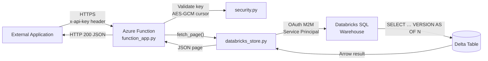

# Databricks Delta Table REST API

A secure, read-only REST API that serves an existing Azure Databricks Delta Table as paginated JSON — built on Azure Functions Python v2 with OAuth M2M backend authentication and API key consumer authentication.

---

## Architecture



---

## Key Features

- **Read-only access** — only `SELECT` and metadata queries are executed; no arbitrary SQL is accepted from consumers
- **Keyset pagination** — cursor-based, works efficiently on tables of any size without `OFFSET`
- **Snapshot consistency** — every page in a session reads from the same Delta table version (`VERSION AS OF`)
- **AES-256-GCM encrypted cursors** — pagination state is encrypted and authenticated; consumers see only an opaque token
- **API key rotation** — active and previous keys are accepted simultaneously during rotation
- **Type-safe JSON** — Decimals serialized as strings, timestamps normalized to ISO 8601, all Databricks types handled correctly
- **No duplicate storage** — reads directly from the existing Delta table; no intermediate copy or cache

---

## Technology Stack

| Component | Technology |
|---|---|
| Runtime | Azure Functions Python v2 (Functions Runtime 4.x) |
| Language | Python 3.11+ |
| Data connector | `databricks-sql-connector[pyarrow]` |
| Backend auth | Databricks SDK — OAuth M2M (`oauth_service_principal`) |
| Cursor encryption | `cryptography` — AES-256-GCM |
| Secret storage | Azure Key Vault (production) |

---

## Project Structure

```
databricks_delta_api_template/
├── function_app.py              # HTTP endpoints: /v1/health and /v1/records
├── databricks_store.py          # Databricks connection, pagination, JSON serialization
├── security.py                  # API key validation, cursor encryption/decryption
├── requirements.txt             # Production dependencies
├── dev-requirements.txt         # Development and test dependencies
├── host.json                    # Azure Functions host configuration
├── local.settings.json.example  # Local configuration template (copy → local.settings.json)
├── .env.example                 # Alternative env-var template
├── openapi.yaml                 # OpenAPI 3.0 specification
├── .gitignore
├── .funcignore
└── tests/
    ├── test_security.py         # API key and cursor unit tests
    ├── test_databricks_store.py # Pagination and serialization tests (mocked)
    ├── test_function_app.py     # HTTP endpoint tests (mocked)
    └── test_databricks_integration.py  # Live Databricks smoke tests (skipped without credentials)
```

---

## Prerequisites

- Python 3.11, 3.12, or 3.13
- [Azure Functions Core Tools v4](https://learn.microsoft.com/en-us/azure/azure-functions/functions-run-local)
- An existing Databricks workspace with:
  - A SQL Warehouse
  - A Delta table you want to expose
  - A Service Principal with OAuth M2M credentials

---

## Configuration

Copy the example settings file and fill in your values:

```bash
cp local.settings.json.example local.settings.json
```

### Required Settings

| Setting | Description | Where to Get It |
|---|---|---|
| `API_KEY_ACTIVE` | Key the external consumer sends in `x-api-key` | Generate yourself (see below) |
| `CURSOR_ENCRYPTION_KEY_ACTIVE` | 32-byte AES key for cursor encryption (Base64URL) | Generate yourself (see below) |
| `DATABRICKS_SERVER_HOSTNAME` | Workspace URL, e.g. `adb-123.4.azuredatabricks.net` | Databricks workspace settings |
| `DATABRICKS_HTTP_PATH` | SQL Warehouse HTTP path, e.g. `/sql/1.0/warehouses/abc123` | SQL Warehouse → Connection details |
| `DATABRICKS_CLIENT_ID` | Service principal application (client) ID | Azure AD / Databricks service principal |
| `DATABRICKS_CLIENT_SECRET` | Service principal OAuth secret | Azure AD / Databricks service principal |
| `TABLE_FQN` | Three-part table name: `catalog.schema.table` | Your Databricks admin |
| `ORDER_KEY_COLUMNS` | Unique, non-null column(s) for keyset ordering, e.g. `id` or `id,created_at` | Your Databricks admin |

### Optional Settings

| Setting | Default | Description |
|---|---|---|
| `API_KEY_PREVIOUS` | _(empty)_ | Previous key — accepted during rotation |
| `CURSOR_ENCRYPTION_KEY_PREVIOUS` | _(empty)_ | Previous cursor key — accepted during rotation |
| `CURSOR_TTL_SECONDS` | `86400` | Cursor expiry (60 – 604800 seconds) |
| `MAX_PAGE_SIZE` | `1000` | Maximum allowed `page_size` per request |
| `MAX_RESPONSE_BYTES` | `4194304` | Maximum HTTP response size (4 MiB) |
| `MAX_SOURCE_AGE_HOURS` | `0` | Reject requests when source data is older than this. `0` = disabled |

### Generate Keys

Run this once to generate your local test keys:

```python
import base64, secrets
print("API_KEY_ACTIVE      :", secrets.token_urlsafe(32))
print("CURSOR_ENCRYPTION_KEY_ACTIVE:", base64.urlsafe_b64encode(secrets.token_bytes(32)).decode().rstrip("="))
```

> **Never commit `local.settings.json` or `.env` to source control.** Both are listed in `.gitignore`.

### ORDER_KEY_COLUMNS Requirements

The ordering key must be **unique** and **non-null** across the entire table. Use a single column (`id`) or a composite key (`customer_id,policy_number`).

Verify uniqueness in Databricks before configuring:

```sql
-- Single key
SELECT COUNT(*) AS total, COUNT(DISTINCT id) AS unique_ids
FROM catalog.schema.table
WHERE id IS NOT NULL;
-- total must equal unique_ids
```

---

## Local Setup

```bash
# 1. Create and activate a virtual environment
python -m venv .venv

# Windows PowerShell
.\.venv\Scripts\Activate.ps1
# macOS / Linux
source .venv/bin/activate

# 2. Install dependencies
pip install -r dev-requirements.txt

# 3. Configure settings
cp local.settings.json.example local.settings.json
# Edit local.settings.json and fill in all values

# 4. Run the Function App locally
func start
```

The API is now available at `http://localhost:7071/api/`.

---

## API Endpoints

### `GET /api/v1/health`

Liveness check. No authentication required. Does not connect to Databricks.

```bash
curl http://localhost:7071/api/v1/health
```

```json
{"success":true,"status":"ok"}
```

---

### `GET /api/v1/records`

Returns one page of records from the configured Delta table.

**Required header:**

```
x-api-key: <your-api-key>
```

**Query parameters:**

| Parameter | Type | Default | Description |
|---|---|---|---|
| `page_size` | integer | `250` | Records per page (1 – 1000) |
| `cursor` | string | — | Opaque token from the previous response's `next_cursor` |

**First page:**

```bash
curl -H "x-api-key: YOUR_KEY" \
  "http://localhost:7071/api/v1/records?page_size=250"
```

**Next page:**

```bash
curl -H "x-api-key: YOUR_KEY" \
  "http://localhost:7071/api/v1/records?page_size=250&cursor=v1.OPAQUE_TOKEN"
```

---

## Sample JSON Response

```json
{
  "success": true,
  "page": 1,
  "page_size": 250,
  "has_more": true,
  "data_as_of": "2025-06-15T10:00:00Z",
  "source_table_version": 42,
  "data": [
    {
      "id": 1001,
      "customer_name": "Acme Corp",
      "amount": "1234.56",
      "created_at": "2025-06-01T08:30:00Z",
      "is_active": true,
      "notes": null
    }
  ],
  "next_cursor": "v1.encrypted_opaque_token_here"
}
```

| Field | Description |
|---|---|
| `has_more` | `true` when more pages exist |
| `data_as_of` | UTC timestamp of the Delta commit being read |
| `source_table_version` | Delta table version number pinned for this session |
| `next_cursor` | Pass as `cursor=` on the next request; `null` on the last page |

### Data Type Mapping

| Databricks type | JSON representation |
|---|---|
| STRING, VARCHAR, CHAR | `"string"` |
| INT, BIGINT, SMALLINT | `123` |
| FLOAT, DOUBLE | `1.5` |
| DECIMAL | `"123.45"` — string to avoid precision loss |
| BOOLEAN | `true` / `false` |
| DATE | `"2025-06-15"` |
| TIMESTAMP | `"2025-06-15T10:00:00Z"` (UTC) |
| TIMESTAMP_NTZ | `"2025-06-15T10:00:00"` (no timezone) |
| NULL | `null` |
| BINARY | Base64-encoded string |
| ARRAY | JSON array |
| STRUCT, MAP | JSON object |

---

## Pagination

Pagination uses a **keyset (cursor) strategy** — it does not use SQL `OFFSET`, so it scales to any table size.

Each cursor is pinned to a specific Delta table version. All pages in a session see the same data snapshot, even if the source table is refreshed mid-pagination.

```
Page 1: GET /records              → data[], next_cursor="v1.AAA", has_more=true
Page 2: GET /records?cursor=v1.AAA → data[], next_cursor="v1.BBB", has_more=true
Page 3: GET /records?cursor=v1.BBB → data[], next_cursor=null,    has_more=false
```

**Cursor expiry:** Cursors expire after `CURSOR_TTL_SECONDS` (default 24 hours). Start a new session when you receive `CURSOR_EXPIRED`.

**Snapshot cleanup:** If Delta's VACUUM removes the pinned version before you finish, you will receive `SNAPSHOT_EXPIRED`. Start a new session.

---

## Error Codes

| HTTP | Code | Cause | Action |
|---|---|---|---|
| 400 | `INVALID_PAGE_SIZE` | `page_size` out of range or non-numeric | Fix the query parameter |
| 400 | `INVALID_CURSOR` | Malformed or tampered cursor token | Start a new session |
| 401 | `UNAUTHORIZED` | Missing or incorrect `x-api-key` | Check your API key |
| 410 | `CURSOR_EXPIRED` | Cursor TTL exceeded | Start a new session (omit cursor) |
| 410 | `SNAPSHOT_EXPIRED` | Delta version vacuumed | Start a new session |
| 413 | `PAGE_TOO_LARGE` | Response exceeds `MAX_RESPONSE_BYTES` | Reduce `page_size`; reuse the same cursor |
| 500 | `SERVER_CONFIGURATION_ERROR` | Missing or invalid backend setting | Contact the API owner |
| 503 | `SOURCE_STALE` | Source data older than `MAX_SOURCE_AGE_HOURS` | Contact the API owner |
| 503 | `DATA_BACKEND_UNAVAILABLE` | Databricks unreachable or query failed | Retry after 30–60 seconds |

All error responses include a `correlation_id` to assist with troubleshooting:

```json
{
  "success": false,
  "error": {
    "code": "UNAUTHORIZED",
    "message": "A valid x-api-key header is required.",
    "correlation_id": "550e8400-e29b-41d4-a716-446655440000"
  }
}
```

---

## Testing

```bash
# Run all unit and mock integration tests
python -m pytest -v

# Run only security tests
python -m pytest tests/test_security.py -v

# Lint
python -m ruff check . --exclude .venv

# Security scan
python -m bandit -r . -x ./.venv,./tests
```

The two tests in `test_databricks_integration.py` connect to a real Databricks workspace. They are **automatically skipped** unless all Databricks environment variables are configured. Run them only against a non-production warehouse and table.

---

## Azure Deployment

### 1. Create the Function App

```bash
az functionapp create \
  --resource-group <your-resource-group> \
  --consumption-plan-location <region> \
  --runtime python \
  --runtime-version 3.12 \
  --functions-version 4 \
  --name <function-app-name> \
  --storage-account <storage-account-name> \
  --os-type Linux
```

### 2. Enable Managed Identity

```bash
az functionapp identity assign \
  --resource-group <your-resource-group> \
  --name <function-app-name>
```

### 3. Store Secrets in Key Vault

```bash
az keyvault secret set --vault-name <vault-name> --name "ApiKeyActive"              --value "<your-api-key>"
az keyvault secret set --vault-name <vault-name> --name "CursorEncryptionKeyActive" --value "<base64url-key>"
az keyvault secret set --vault-name <vault-name> --name "DatabricksClientSecret"    --value "<oauth-secret>"

# Grant the Function App's managed identity read access
az keyvault set-policy \
  --name <vault-name> \
  --object-id <managed-identity-principal-id> \
  --secret-permissions get
```

### 4. Configure Application Settings

In **Azure Portal → Function App → Configuration → Application settings**, add each setting. For secrets, use Key Vault references:

```
API_KEY_ACTIVE                    @Microsoft.KeyVault(VaultName=<vault>;SecretName=ApiKeyActive)
CURSOR_ENCRYPTION_KEY_ACTIVE      @Microsoft.KeyVault(VaultName=<vault>;SecretName=CursorEncryptionKeyActive)
DATABRICKS_CLIENT_SECRET          @Microsoft.KeyVault(VaultName=<vault>;SecretName=DatabricksClientSecret)
DATABRICKS_SERVER_HOSTNAME        adb-<workspace-id>.<region>.azuredatabricks.net
DATABRICKS_HTTP_PATH              /sql/1.0/warehouses/<warehouse-id>
DATABRICKS_CLIENT_ID              <service-principal-application-id>
TABLE_FQN                         catalog.schema.table
ORDER_KEY_COLUMNS                 <key-column(s)>
```

### 5. Deploy

```bash
func azure functionapp publish <function-app-name>
```

### 6. Enable HTTPS Only

In **Azure Portal → Function App → TLS/SSL settings**:
- **HTTPS Only:** On
- **Minimum TLS Version:** 1.2

### 7. Verify

```bash
curl https://<function-app-name>.azurewebsites.net/api/v1/health
```

---

## Troubleshooting

| Symptom | Likely Cause | Fix |
|---|---|---|
| `401 UNAUTHORIZED` | Wrong or missing `x-api-key` | Check the header value matches `API_KEY_ACTIVE` |
| `500 SERVER_CONFIGURATION_ERROR` | Missing required setting | Check all required settings are set; check Key Vault reference status |
| `503 DATA_BACKEND_UNAVAILABLE` | Warehouse stopped or OAuth error | Verify the warehouse is running; check service principal permissions |
| `503 SOURCE_STALE` | Table not refreshed recently | Check `MAX_SOURCE_AGE_HOURS` and the upstream ETL job |
| `410 SNAPSHOT_EXPIRED` | Delta VACUUM removed pinned version | Increase Delta retention or reduce cursor TTL; start a new session |
| `413 PAGE_TOO_LARGE` | Rows are very wide | Reduce `page_size` to 50–100 and retry with the same cursor |
| Warehouse auto-starts on health check | Expected — `/health` does not query Databricks | Use `/records` with a minimal query for readiness probing |
| Key Vault reference shows "Invalid" | Managed identity not granted access | Re-run the `az keyvault set-policy` command and redeploy |

---

## Key Rotation

**API key rotation:**

1. Generate a new key.
2. Set `API_KEY_PREVIOUS` to the current `API_KEY_ACTIVE` value.
3. Set `API_KEY_ACTIVE` to the new key.
4. Notify the external consumer; once they confirm they are using the new key, clear `API_KEY_PREVIOUS`.

**Cursor encryption key rotation** follows the same pattern using `CURSOR_ENCRYPTION_KEY_ACTIVE` and `CURSOR_ENCRYPTION_KEY_PREVIOUS`. Existing cursors encrypted with the old key remain valid until they expire.
